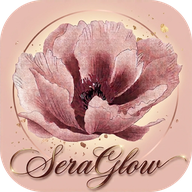
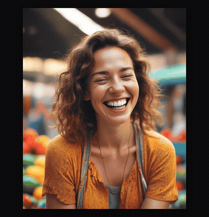
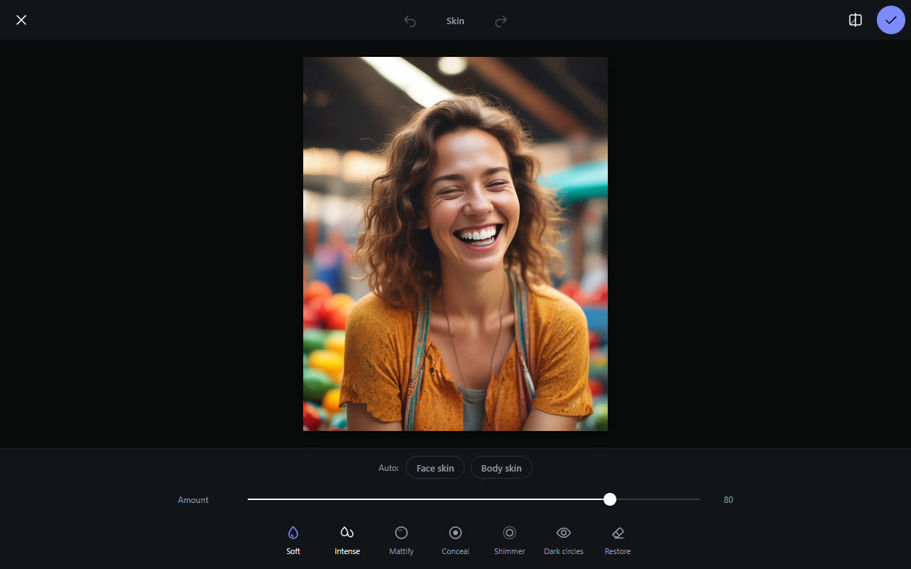
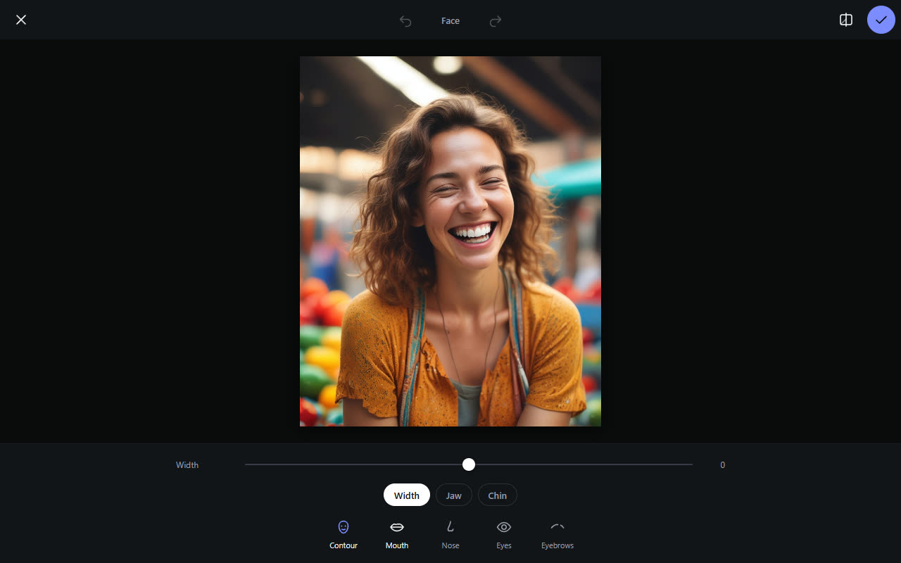
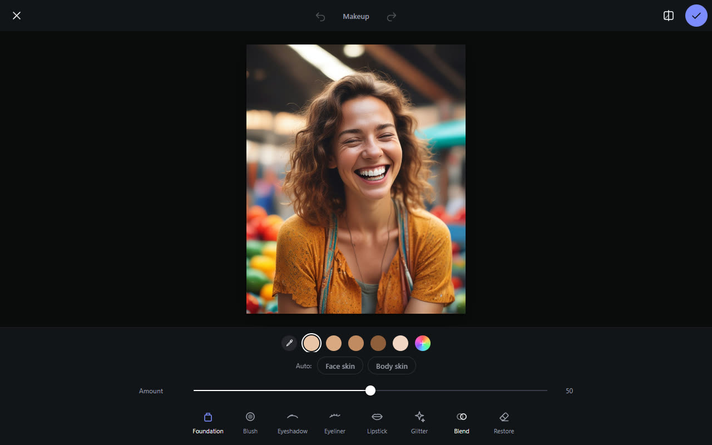
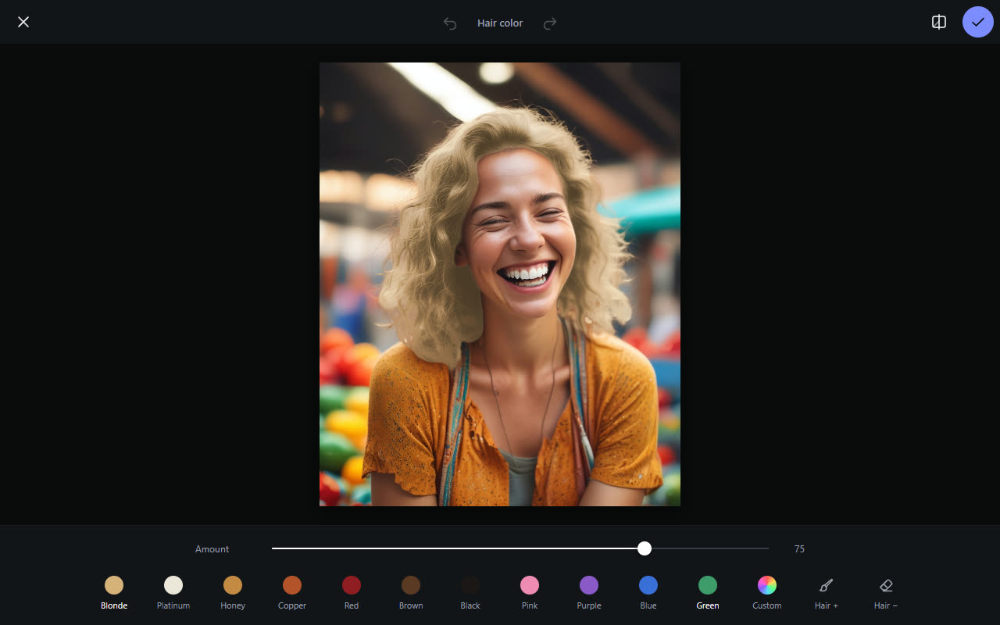
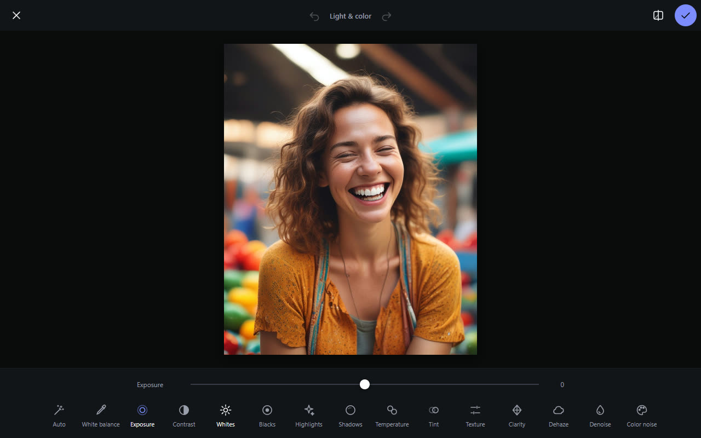
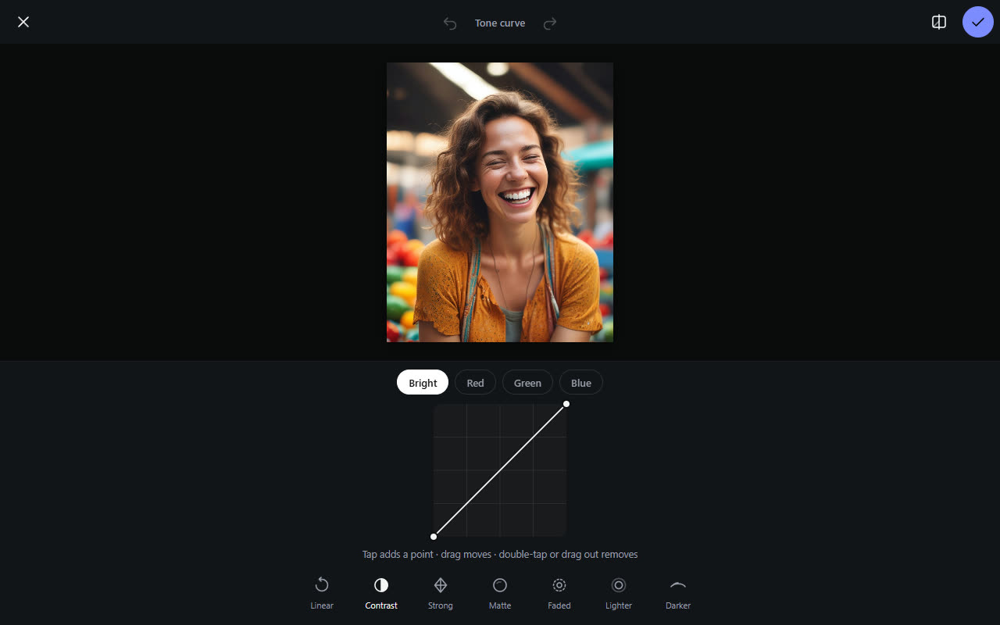
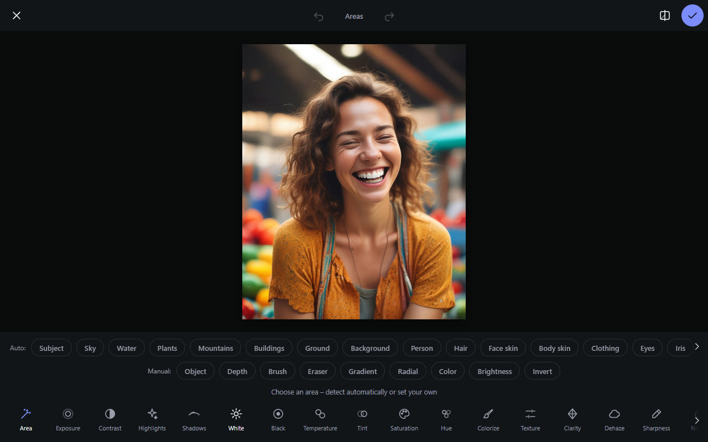
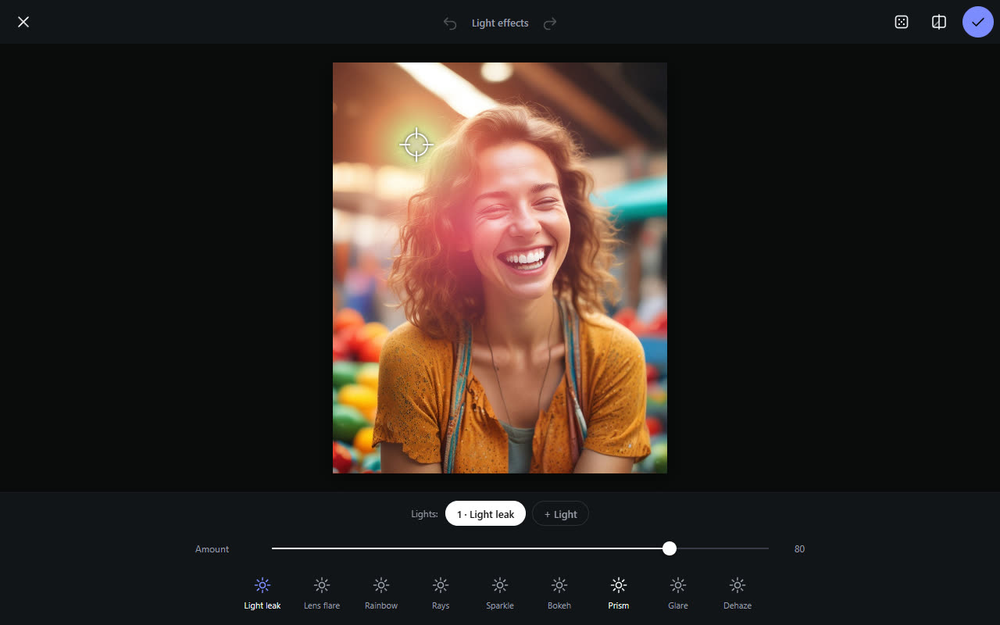

<div align="center">



# SeraGlow

**A portrait photo editor that runs entirely on your own machine.**

No account. No subscription. No cloud. Your photos never leave your device.


</div>

> **This repository is a work sample.** The source code is not public. It shows what the project does and how it is built. I'm happy to walk through the code in an interview.

## Why SeraGlow?

Portrait retouching apps have drifted toward subscriptions and cloud uploads of your face. SeraGlow goes the other way:

- **Local-first.** Photos and projects live in your browser's IndexedDB. Nothing is uploaded.
- **GPU fast.** Light, color and warping run in WebGL2, so sliders respond instantly.
- **Region-aware.** Pick subject, sky, skin, hair, eyes, lips or teeth automatically, or paint your own region.
- **Own AI, trained on my own GPU.** Small models for mouth, eyebrows, eyes and sky, trained with CUDA.

## Features

| Area | What you get |
| --- | --- |
| **Portrait** | Edge-preserving skin retouching, glow, sharpness, mesh-warp reshaping, face parts, eyes, pigment-based makeup, hair color, quick retouch |
| **Color & Light** | Light & color, tone curve, color channels, color mood, styles, light effects |
| **Image & Scene** | Crop, proportions, blur, cutout without color fringes, background, sky, object removal |
| **Regions** | Automatic masks (subject, sky, skin, hair, eyes, lips, teeth …) plus brush, eraser, gradients, color and luminance range |
| **Workflow** | Zoom, brush, before/after compare, undo/redo, autosave, export up to 4096 px |

## Gallery

<div align="center">



<sub>Styles and profiles, applied live on the GPU</sub>

</div>

<table>
  <tr>
    <td></td>
    <td></td>
  </tr>
  <tr>
    <td align="center">Skin: soft, intense, mattify, conceal, with automatic face and body skin selection</td>
    <td align="center">Face: contour, mouth, nose, eyes and eyebrows</td>
  </tr>
  <tr>
    <td></td>
    <td></td>
  </tr>
  <tr>
    <td align="center">Makeup as pigment: foundation, blush, eyeshadow, eyeliner, lipstick</td>
    <td align="center">Hair color with automatic hair detection</td>
  </tr>
  <tr>
    <td></td>
    <td></td>
  </tr>
  <tr>
    <td align="center">Light &amp; color with white balance and 20+ sliders</td>
    <td align="center">Tone curve with RGB and per-channel points</td>
  </tr>
  <tr>
    <td></td>
    <td></td>
  </tr>
  <tr>
    <td align="center">Regions: subject, sky, skin, hair, eyes, lips … or paint your own</td>
    <td align="center">Light effects: light leak, lens flare, rainbow, bokeh, prism</td>
  </tr>
</table>

All sample photos were generated by an image model and show no real people.

## AI, CUDA and lots of images

Image processing runs in the browser (Canvas, WebGL2, Web Workers). Heavy tasks use an **optional local AI service** (Python, CUDA); without it the app falls back to built-in methods.

- **Trained with CUDA:** small networks for mouth, eyebrows, eyes and sky, trained on an RTX 5060 Laptop (8 GB) with long-running training and checks on real photos.
- **Lots of generated images:** sample images and large parts of the training data come from image models (SDXL-Lightning), with masks and pairs built automatically. Real photos only with a verified license.
- **Integrated models:** MediaPipe in the browser; SAM 2, BiRefNet, Depth Anything V2 (Small), Real-ESRGAN and SCUNet in the local service.
- **Memory management:** models move between GPU and system RAM on demand, so 8 GB is enough.

## How it works

```
 photo ──► MediaPipe (face mesh, segmentation)
              │
 edit settings┤   WebGL2 pipeline: light, color, curves, warp, regions
              ▼
        brush / mask tools ─► canvas ─► export (JPEG / PNG)
              ▲
   optional local AI service (CUDA): select, cutout, depth, inpaint, upscale
```

| Folder (private) | Contents |
| --- | --- |
| `src/engine` | Brushes, effects, mesh warp, skin retouching, makeup, segmentation, object removal |
| `src/develop` | WebGL2 engine for light, color, curves and regions |
| `src/tools` | One tool per file |
| `src/ui` | React interface |
| `src/store` | Projects in IndexedDB |

## Roadmap

- Better sky detection in edge cases
- Smoother inpainting over very large areas
- Fine baby hairs in hair coloring
- Video editor (planned, not built yet)
