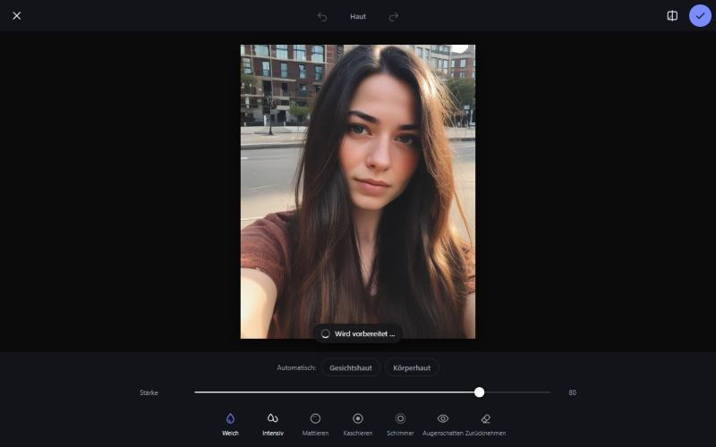

*No accounts, no subscription, no cloud required.*

---

> 👀 **This is a work sample.** The source code is not public. This page shows what the project can do and how I built it. I'm happy to walk through the code in an interview.

## ✨ What is it?

SeraGlow is a portrait photo editor built with **React, Vite and TypeScript**. Everything runs in the browser: photos and projects stay on the device and **nothing is uploaded**. I design, build and test it on my own.

The sample photo was generated by an image model and shows no real person.

## 🧰 What can it do?

- **Portrait:** edge-preserving skin retouching, glow, sharpness, mesh-warp reshaping (WebGL2), face parts, eyes, pigment-based makeup, hair color
- **Color & light:** light & color, tone curve, color channels, color mood, styles, light effects
- **Image & scene:** crop, proportions, blur, background and cutout without color fringes, sky, object removal
- **Regions:** select automatically (subject, sky, skin, hair, eyes, lips, teeth …) or paint your own, then edit just that area
- **Comfort:** zoom, brush, before/after compare, undo, autosave, export up to 4096 px

## 🧠 AI, CUDA and lots of images

Image processing runs in the browser (Canvas, WebGL2, Web Workers). Heavy tasks use an **optional local AI service** (Python, CUDA); without it the app falls back to built-in methods.

- **Own models trained with CUDA:** small networks for mouth, eyebrows, eyes and sky, trained on my own GPU (RTX 5060 Laptop, 8 GB), with long-running training and checks on real photos
- **Many images generated myself:** sample images and large parts of the training data come from image models (SDXL-Lightning), with masks and pairs built automatically. Real photos only with a verified license.
- **Integrated:** MediaPipe in the browser; in the local service SAM 2, BiRefNet, Depth Anything V2 (Small), Real-ESRGAN, SCUNet and others
- **Memory management:** models are moved deliberately between GPU and system RAM so 8 GB is enough

## 🔭 Still open

Sky detection in edge cases, very large areas when inpainting, fine baby hairs in hair coloring, and a **video editor** (planned, not built yet).

