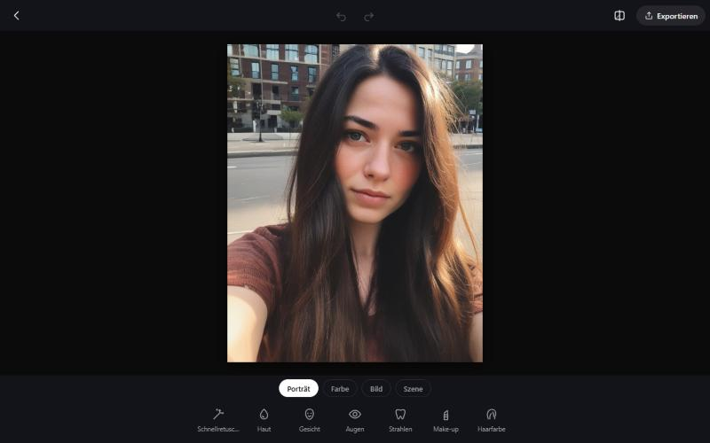

*Keine Accounts, kein Abo, keine Cloud-Pflicht.*

---

> 👀 **Dies ist eine Arbeitsprobe.** Der Quellcode ist nicht öffentlich. Hier steht, was das Projekt kann und wie ich es gebaut habe. Den Code zeige ich gern im Gespräch.

## ✨ Was ist das?

SeraGlow ist ein Foto-Editor für Porträts, gebaut mit **React, Vite und TypeScript**. Alles läuft im Browser: Fotos und Projekte bleiben auf dem Gerät, **nichts wird hochgeladen**. Ich plane, baue und teste es allein.

Das Beispielfoto ist von einem Bildmodell erzeugt, es zeigt keine echte Person.

## 🧰 Was kann es?

- **Porträt:** Hautretusche (kantenerhaltend), Strahlen, Schärfe, Verformen per Netz-Warp (WebGL2), Gesichtsteile, Augen, Make-up als Pigment, Haarfarbe
- **Farbe & Licht:** Licht & Farbe, Tonkurve, Farbkanäle, Farbstimmung, Stile, Lichteffekte
- **Bild & Szene:** Zuschneiden, Proportionen, Unschärfe, Hintergrund und Freistellen ohne Farbsaum, Himmel, Objekt entfernen
- **Bereiche:** automatisch wählen (Motiv, Himmel, Haut, Haare, Augen, Lippen, Zähne …) oder selbst malen und gezielt bearbeiten
- **Komfort:** Zoomen, Pinsel, Vergleichen, Rückgängig, automatisches Speichern, Export bis 4096 px

## 🧠 KI, CUDA und viele Bilder

Die Bildverarbeitung läuft im Browser (Canvas, WebGL2, Web Worker). Für schwere Aufgaben gibt es einen **optionalen lokalen KI-Dienst** (Python, CUDA); ohne ihn nutzt die App eingebaute Verfahren.

- **Eigene Modelle mit CUDA trainiert:** kleine Netze für Mund, Brauen, Augen und Himmel, trainiert auf meiner eigenen GPU (RTX 5060 Laptop, 8 GB), mit Dauertraining und Prüfung an echten Fotos
- **Viele Bilder selbst erzeugt:** Beispielbilder und große Teile der Trainingsdaten stammen aus Bildmodellen (SDXL-Lightning), Masken und Paare dazu automatisch gebaut. Echte Fotos nur mit geprüfter Lizenz.
- **Eingebunden:** MediaPipe im Browser, im lokalen Dienst u. a. SAM 2, BiRefNet, Depth Anything V2 (Small), Real-ESRGAN, SCUNet
- **Speicherverwaltung:** Modelle wandern gezielt zwischen Grafikkarte und Arbeitsspeicher, damit 8 GB reichen

## 🔭 Noch offen

Himmel-Erkennung in Randfällen, sehr große Flächen beim Ausbessern, feine Babyhaare bei der Haarfarbe und ein **Video-Editor** (geplant, noch nicht gebaut).

